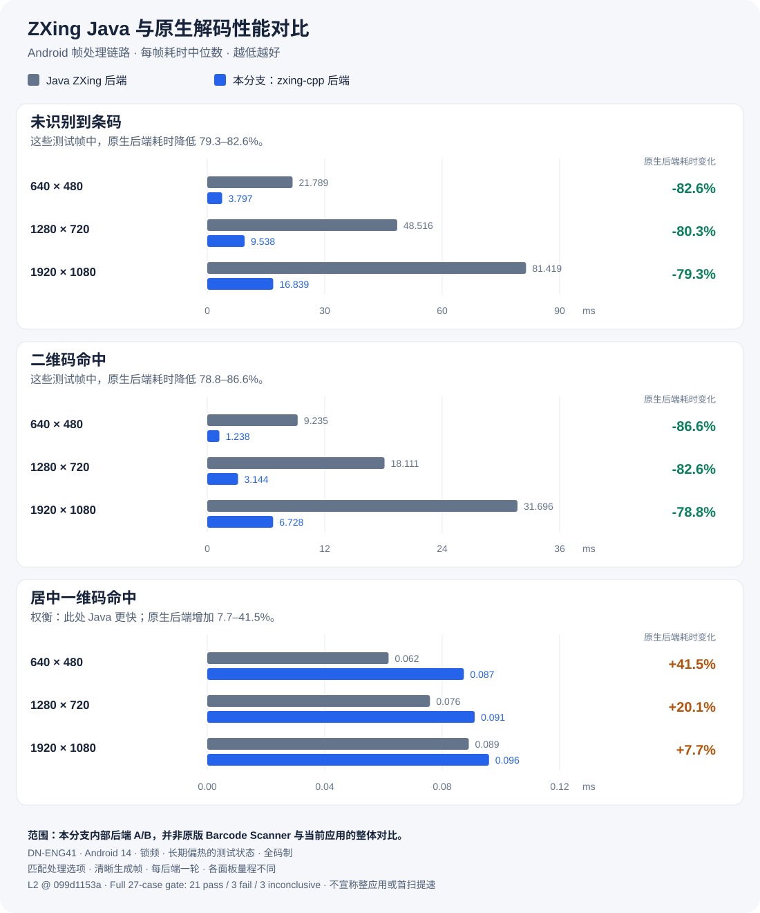
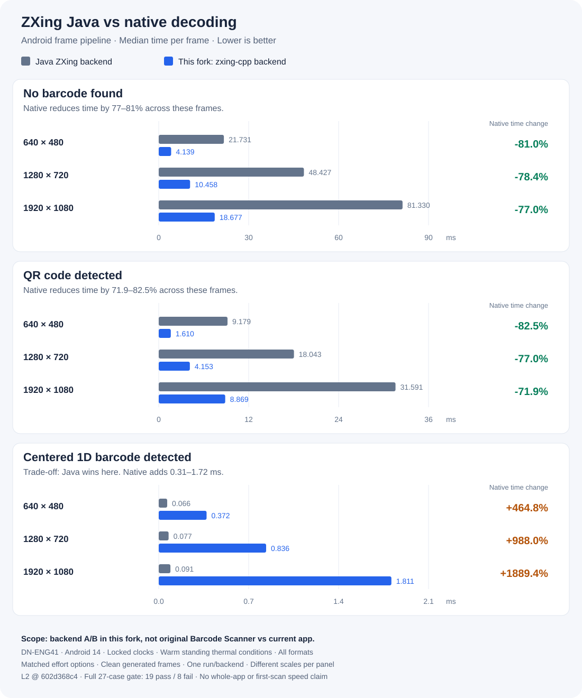

# ZXing Android

[简体中文](#简体中文) · [English](#english)

## 简体中文

基于 [ZXing](https://github.com/zxing/zxing) 的独立 Android 社区维护项目，持续改进扫码应用与可复用扫描库。

### 相比原版 ZXing 的改进

以下对比针对原仓库的 **Android 应用与集成代码**，不代表原版 Java 解码核心无法在新系统运行。

| 方面 | 原版 ZXing Android | 本项目 |
| --- | --- | --- |
| 高版本 Android | 旧 Barcode Scanner 不再更新，原 Android 工程 targetSdk 22 | targetSdk 36；适配运行时权限、边到边显示、预测性返回及大屏布局；Android 14/15 真机验证，Android 16 模拟器验证 |
| Kotlin 重构 | Android 代码以 Java 为主 | 应用、扫描库与 Intent 集成模块已转为 Kotlin，保留 Java 调用兼容测试；core 仍为 Java |
| 解码性能 | Java 解码路径 | 增加并默认使用 zxing-cpp 原生后端，保留 Java 后端；二维码与全码制未命中场景有实测收益，见下图 |
| 相机与帧处理 | Camera1 相机链路，在主线程上同步打开相机 | 保留 Camera1，新增可选 CameraX；**相机改为在工作线程打开**，启动时不再阻塞主线程（实测该阻塞为 401–436 ms）；支持原位读取亮度平面，减少不必要的整帧复制 |
| 应用集成 | 原应用代码与 Intent 辅助集成 | 提供可复用的 ScannerView / AAR，支持会话隔离、错误回调和扫描中更新码制 |
| 问题修复 | 历史 Android 实现 | 修复扫描区域旋转/镜像映射、现代文件分享、Wi-Fi 添加流程、补光灯控制等问题 |
| 性能验证 | 核心解码测试 | 增加 Android 帧链路、相机启动和持续扫描 benchmark，公开原始结果与回归判定 |

扫码继续保持**完全离线、无需 GMS**；这也是原版已有的特点。Kotlin 重构改善维护性，本身不作为提速依据。原生库已检查 16 KB 对齐，16 KB 页真机仍待验证。

### 性能对比

**本分支内部 Java ZXing 与 zxing-cpp 解码后端的对比，不是原版 App 与当前 App 的整体提速。**

本轮无码帧耗时降低 **77–81%**，二维码命中耗时降低 **71.9–82.5%**；居中一维码命中则是 Java 更快。完整 27 项测试为 **19 项通过 / 8 项失败**。

测试条件：DN-ENG41、Android 14、锁频、长期偏热状态；提交 `602d368c4`，每后端一轮，相同生成帧及匹配处理选项。图中展示全部 9 个默认全码制场景，各面板量程不同。结果不代表其他设备、后续版本、真实首扫或续航表现。

[测试方法](docs/maint/BENCHMARKS.md#106c-the-first-backend-ab-measured) · [完整结果](docs/maint/reports/l2-ab-602d368c4-DN-ENG41-verdict.md) · [原始数据](docs/maint/reports/l2-ab-602d368c4-DN-ENG41-cases.csv)

**后续重点：** 扩大 Android 16、低端及非高通真机覆盖，继续优化一维码性能、真实首扫和持续扫描开销。

[集成与构建说明、历史进度](docs/maint/PROJECT_DETAILS.md#简体中文) · [发布与获取](docs/maint/PUBLISHING.md)

---

## English

An independent Android community maintenance project based on [ZXing](https://github.com/zxing/zxing), improving the scanner app and reusable scanning library.

### Improvements over upstream ZXing

This compares the original repository's **Android app and integration code**, not whether the upstream Java decoder can run on modern Android.

| Area | Upstream ZXing Android | This project |
| --- | --- | --- |
| Modern Android | Legacy Barcode Scanner no longer updated; Android project targets SDK 22 | Targets SDK 36; runtime permissions, edge-to-edge, predictive back and large-screen layouts; Android 14/15 verified on hardware, Android 16 on emulators |
| Kotlin refactoring | Android code primarily in Java | App, scanner and Intent integration modules converted to Kotlin, with Java-call compatibility tests; core remains Java |
| Decoding performance | Java decoding path | Adds zxing-cpp as the default native backend while retaining Java; measured gains on QR hits and all-format misses, shown below |
| Camera and frame processing | Camera1 pipeline, opening the camera synchronously on the main thread | Retains Camera1 and adds optional CameraX; **the camera opens on a worker thread**, so startup no longer blocks the main thread (measured at 401–436 ms); reads luma planes in place to reduce unnecessary full-frame copies |
| App integration | Original app code and Intent helpers | Reusable ScannerView / AAR, session isolation, error callbacks and live format updates |
| Bug fixes | Historical Android implementation | Fixes ROI rotation/mirroring, modern file sharing, Wi-Fi setup, torch control and other defects |
| Performance validation | Core decoder tests | Adds Android frame-pipeline, camera-startup and sustained-scanning benchmarks, with raw results and regression verdicts |

Scanning remains **fully offline and GMS-free**, as it was upstream. Kotlin improves maintainability; the rewrite alone is not evidence of a speedup. Native libraries have been checked for 16 KB alignment; hardware with 16 KB pages is still unverified.

### Performance comparison

**This compares the Java ZXing and zxing-cpp decoder backends within this fork, not the original app against the current app.**

In this run, time drops **77–81% on no-barcode frames** and **71.9–82.5% on QR hits**; Java wins on centered 1D hits. The full 27-case matrix reports **19 pass / 8 fail**.

Conditions: DN-ENG41, Android 14, locked clocks and standing warm thermal conditions; commit `602d368c4`, one run per backend, identical generated frames and matched effort options. The chart shows all nine default/all-format cases, with different scales per panel. Results do not establish performance on other devices, later versions, real-camera first scans or battery life.

[Method](docs/maint/BENCHMARKS.md#106c-the-first-backend-ab-measured) · [Full results](docs/maint/reports/l2-ab-602d368c4-DN-ENG41-verdict.md) · [Raw data](docs/maint/reports/l2-ab-602d368c4-DN-ENG41-cases.csv)

**Next priorities:** broaden Android 16, low-end and non-Qualcomm hardware coverage; improve 1D performance, real-camera first-scan latency and sustained-scanning cost.

[Integration, building and historical progress](docs/maint/PROJECT_DETAILS.md#english) · [Releases and distribution](docs/maint/PUBLISHING.md)

---

独立维护，非 ZXing 官方项目。保留原版权，采用 [Apache-2.0](LICENSE) 许可证。  
Independently maintained, not an official ZXing project. Original copyrights retained; licensed under [Apache-2.0](LICENSE).
