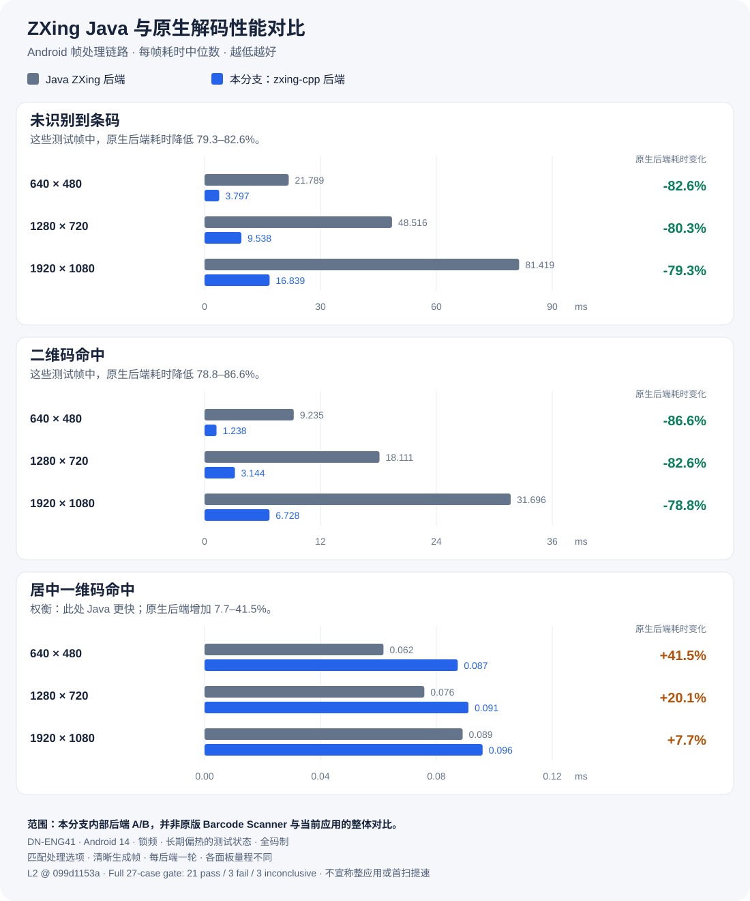
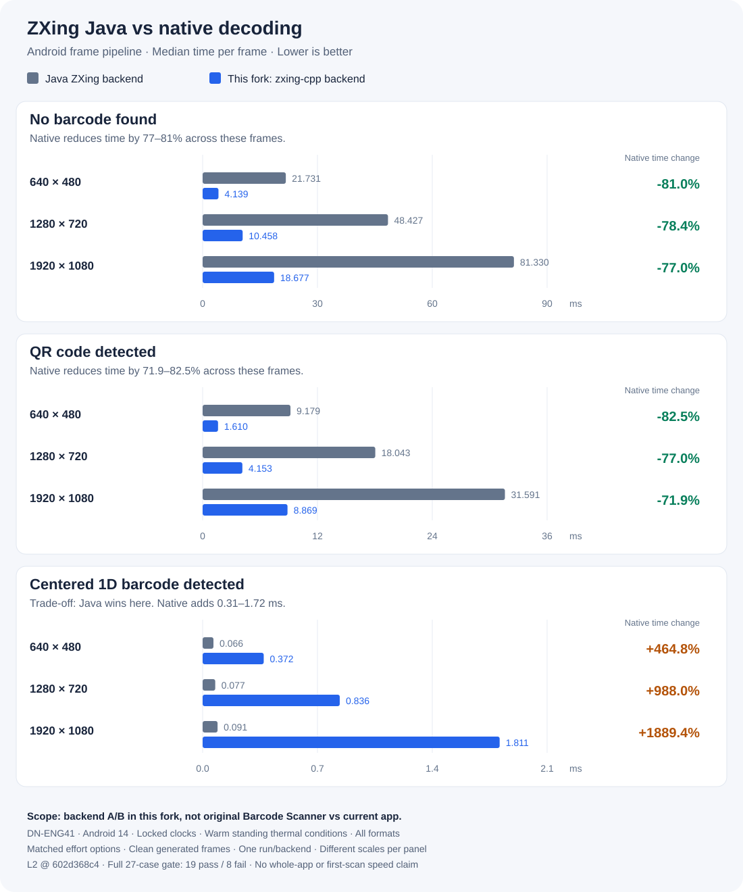

<!-- README archive: integration examples, building instructions and historical progress. Consult current reports and source for the latest status. -->

# ZXing Android — 社区维护分支 / Community maintenance fork

[简体中文](#简体中文) · [English](#english)

<a id="简体中文"></a>

## 简体中文

这是 [zxing/zxing](https://github.com/zxing/zxing) Android 部分的独立社区维护分支，包含 **Barcode Scanner 扫码应用**和可复用的扫描库。

> **本项目与 ZXing 官方无隶属关系，未经其背书，也不由其发布。** 本分支没有使用上游签名，无法直接升级已发布的官方 Barcode Scanner 应用。保留原项目版权和 Apache-2.0 许可证。

上游 Android 模块多年未能在现代工具链上构建：它们依赖仅在 `<jdk>[,9)</jdk>` 条件下启用的 Maven profile 和无人维护的 `android-maven-plugin`，`targetSdk` 为 22。本分支让这些代码在现代 Android 上重新构建、运行并持续演进，同时把扫描链路整理为可复用组件，避免靠复制粘贴集成。

### 性能对比一览



**这是解码后端实测对比，不是相对于原版 Barcode Scanner 的整应用提速。** 对比的是本分支在 `602d368c4` 时的 Java ZXing 和 zxing-cpp 两条路径，使用相同的生成帧，并匹配额外重试等处理选项。图中展示**全部 9 个默认全码制场景**，包括 Java 更快的居中一维码命中场景。三个面板分别采用从零开始、量程不同的线性坐标轴；百分比表示**耗时变化**，不是吞吐量变化。

本轮在 DN-ENG41（Android 14）上，原生后端的逐帧链路耗时中位数在**无码帧下降低 77–81%**，在**二维码命中时降低 71.9–82.5%**。居中一维码命中则更慢：原生为 **0.372–1.811 ms**，Java 为 **0.066–0.091 ms**。**完整 27 项测试矩阵**的门槛判定为 **19 项通过 / 8 项失败**，因此不能宣称全面领先。

**限制：** 只有一台真机，每个后端运行一轮，锁定时钟，并处于参考设备长期存在的偏热/热状态条件下（包括报告中明确列出的、按协议允许对等比较的警告）。这些清晰回放帧不能衡量真实相机首扫延迟、续航或一般设备性能。数据仅对应实测提交，不自动代表后续所有版本。

[方法与解读](BENCHMARKS.md#106c-the-first-backend-ab-measured) · [完整 27 项结果与判定](reports/l2-ab-602d368c4-DN-ENG41-verdict.md) · [原始数据 CSV](reports/l2-ab-602d368c4-DN-ENG41-cases.csv) · [语料识别正确性与回退项](BENCHMARKS.md#91-l1-on-a-device--the-accuracy-question-the-native-default-was-missing)

### 仓库组成

| 模块 | 用途 |
| --- | --- |
| `scanner/` | **AAR 扫描库**：`ScannerView`、相机与解码链路 |
| `android/` | 基于 AAR 的 Barcode Scanner 应用 |
| `core/` | 从 ZXing core 派生并在此维护的解码器 |
| `android-integration/` | 供第三方应用嵌入的 Intent 调用辅助库 |
| `benchmark/` | 数据集清单和 L1 正确性/耗时测试程序 |

不维护桌面端（`javase`）及 Web 模块，详见 [迁移说明](MIGRATION.md)。

### 使用扫描库

```kotlin
dependencies {
  // 同时引入解码器 io.github.kakakakacat.zxing:zxing-core。
  implementation("io.github.kakakakacat.zxing:zxing-android-scanner:0.1.0")
}
```

自第一个经 Central 发布的版本起，消费方无需配置仓库也无需 token；在那之前请用 GitHub
Packages 或 JitPack。三者的配置见 [发布与集成说明](PUBLISHING.md)。

```xml
<io.github.kakakakacat.zxing.android.scanner.ScannerView
    android:id="@+id/scanner_view"
    android:layout_width="match_parent"
    android:layout_height="match_parent"/>
```

```java
scannerView = findViewById(R.id.scanner_view);
scannerView.setOptions(new ScannerOptions.Builder()
    .setAutoFocus(true)
    .setFrontLightMode(FrontLightMode.AUTO)
    .build());
scannerView.setFormats(EnumSet.of(BarcodeFormat.QR_CODE));   // null 表示全部码制
// 扫描过程中可再次调用 setFormats：直接更新运行中的解码器，无需重启相机。
scannerView.setListener(new ScannerView.Listener() {
  @Override public void onScanned(ScanOutcome outcome) {
    String text = outcome.getResult().getText();
    // 如需继续扫描，调用 scannerView.resumeScanning()
  }
  @Override public void onScannerError(ScannerError error, Exception cause) {
    // PERMISSION_DENIED / NO_CAMERA / CAMERA_UNAVAILABLE / PREVIEW_FAILED
  }
});

@Override protected void onResume() { super.onResume(); scannerView.resume(); }
@Override protected void onPause()  { scannerView.pause(); super.onPause(); }
```

以上示例类型位于 `io.github.kakakakacat.zxing.android.scanner`，**但 `FrontLightMode` 除外**，它位于 `io.github.kakakakacat.zxing.android.camera`，描述由 `ScannerCamera` 管理的补光灯模式，两种相机后端均可访问。

**宿主应用需自行申请 `CAMERA` 权限。** `ScannerView` 不弹出授权对话框；缺少权限时通过 `ScannerError.PERMISSION_DENIED` 报错，由宿主与用户交互。`android/` 中的 `CaptureActivity` 提供完整示例，包含“不再询问”的处理。

**选择相机后端：** `ScannerView` 默认使用 Camera1，也可显式选择 CameraX：

```kotlin
scannerView.setOptions(
    ScannerOptions.Builder()
        .setCameraBackend(ScannerOptions.CameraBackend.CAMERAX)
        .build())
```

CameraX 不依赖 `camera-view`，直接向扫描器已有的 `SurfaceView` 输出预览；当前只考虑后置相机，亮度平面原位交给解码器读取，不逐帧复制。两种后端并存的原因、各自成本及 CameraX 尚未验证的内容见 [相机后端决策记录](decisions/0001-camera-backend.md)。

**使用宿主自己的 CameraX 帧：** `YPlaneLuminanceSource` 可以直接包装 `YUV_420_888` 图像的亮度平面。传入 `getPlanes()[0]` 的 buffer、`rowStride`、`pixelStride` 和扫描区域。它处理行填充和交错步长，只复制扫描区域，不改变 buffer 的 position。buffer 必须在解码结束前有效，否则先调用 `detach()`。这适用于宿主自行管理相机、只使用解码器的场景。

**尽量缩小码制集合。** `setFormats` 是库中成本最低的性能控制手段，扫描中也可随时修改并传递到运行中的解码器，无需重新打开相机。参考设备上，1920×1080 无码预览帧在全码制下耗时约 **81 ms**，仅启用一种一维码时约 **1.2 ms**；这对应预览中经常遇到的未识别路径。限制码制也有助于避免误识别：语料中两张图片被全码制读取器识别成了错误码制。数据和方法见 [BENCHMARKS.md](BENCHMARKS.md) 第 9、10 节。

结果在主线程回调，并携带产生该结果的扫描会话 ID。`pause()` 之后才完成的解码结果会被丢弃，不会送入已经离开的界面。

**结果里有什么。** 原生后端返回的 `Result` 除文本外还带原始字节与元数据：

- `getRawBytes()` 是**按码制定义的解码内容字节，未经字符集转换**，即 zxing-cpp 的 `bytes()`。这与 Java 后端不同：Java 后端的二维码读取器放在这里的是符号的码字（codeword），而 zxing-cpp 不提供码字。两个后端在这一个字段上有意不一致，且仅此一处。一维码上 Java 后端本来就不返回原始字节，所以这里是净增。
- 这些字节是符号本身的，不是把展示字符串重新编码得来的：兼容渲染已经改写过 UPC-A 前导零、UPC-E 展开、Codabar 首尾符和 RSS-14 的 AI 前缀，字节保持原样。
- 元数据逐项映射：纠错级别、AIM 符号学标识符、EAN/UPC 附加码、reader-init、以及二维码的结构化追加。zxing-cpp 不报告的项（`BYTE_SEGMENTS`、纠错数、方向、国家码等）一律缺省，不编造。
- **携带 ECI 的符号的符号学标识符**：zxing-cpp 知道 ECI 的 modifier 偏移却不应用它，二维码因此返回 `]Q1`，而 ISO/IEC 15424 和本仓库自己的读取器都是 `]Q2`。二维码已修正；偏移量 zxing-cpp 未暴露的码制则不返回标识符，而不是返回一个错的。

**文本编码。** 文本以显式的 UTF-8→UTF-16 转换跨越 JNI 边界，带长度调用 `NewString`。内嵌 `U+0000` 不再截断结果，emoji 和补充平面汉字按原字符返回。非法字节序列变为 U+FFFD，不丢弃也不透传。

**解码器起不来时会报错，不再静默。** `DecoderBackend.NATIVE` 在没有对应 ABI 原生库的设备上、或码制集合 zxing-cpp 无法接受时，`ScannerView` 报 `ScannerError.DECODER_UNAVAILABLE` 并带上原因；解码器连续在十帧上抛异常也是同一个错误。单帧抛异常只丢这一帧，继续扫描。`DecoderBackend.AUTO` 仍会自动退回 Java 解码器。

**什么时候生效。** `setFormats` 对运行中的会话立即生效；`setThumbnailsEnabled` 在下一次 `resume()` 生效——解码线程创建时读取一次。

**作为 AAR 嵌入宿主。** 扫描视图不要求占满屏幕，也不会动宿主自己的相机：

- 扫描框按 **`ScannerView` 自身的尺寸**计算，不再按 `WindowManager` 的显示尺寸。半屏、弹窗、分屏、带偏移的布局下，用户对准的框和实际解码的区域才是同一个。尺寸变化、旋转、分屏拖动都会让缓存失效。
- CameraX 后端只解绑**自己的** `Preview` 和 `ImageAnalysis`，不再调用 `unbindAll()`——后者会拆掉整个进程里所有 use case，包括宿主自己的预览和拍照。
- `ProcessCameraProvider.configureInstance` 是进程级、只能调用一次的配置，默认**不由本库调用**。需要时用 `setCameraXProcessConfiguration(true)` 显式开启：单相机设备上可省下约 5.9 秒的 CameraX 双朝向校验，双相机设备上没有差别。宿主若自己用 `CameraXConfig.Provider`，保持关闭即可。
- `getCameraCapabilities()` 列出当前后端真正会应用哪些选项。CameraX 路径不应用 `cameraId`、对焦、测光、曝光、场景模式和 `invertScan`——这些交给 CameraX 自己的 3A；后端每个会话也会打一条日志说明。需要逐项控制请用 `CameraBackend.CAMERA1`。
- `resume()` 可以在视图已经显示之后调用。此前回调只在 `resume()` 里、且只在 surface 尚未创建时注册，而 `SurfaceHolder` 不会给后注册的回调补发 `surfaceCreated`，于是从标签页、复用的弹窗或按钮里启动的扫描器不会打开相机，也不报错。

### 构建

需要 JDK 17+、Android SDK platform 36 和 build-tools 36.0.0。Gradle 与 AGP 版本已固定，wrapper 会自行下载 Gradle。

```sh
./gradlew :scanner:assembleRelease     # AAR
./gradlew :app:assembleDebug           # 调试签名的应用
./gradlew :scanner:connectedDebugAndroidTest   # 固定帧解码测试，需要设备
./gradlew :benchmark-jvm:run --args="--config default"   # 主机端 L1 正确性/耗时
benchmark/tools/l1_device.sh --backend native            # 设备端 L1 正确性
```

应用的 `assembleRelease` 生成**未签名** APK；仓库没有、也不应提交生产签名配置。

### 支持范围

| 项目 | 说明 |
| --- | --- |
| `minSdk` | 23（上游为 19，后升至 21，再升至 23；见 [AUDIT.md](AUDIT.md) 第 2 节和[相机后端决策](decisions/0001-camera-backend.md)） |
| `compileSdk` / `targetSdk` | 36 |
| 相机 | 默认 Camera1（`android.hardware.Camera`）；可通过 `ScannerOptions.setCameraBackend(CAMERAX)` 启用 **CameraX**，见[决策记录](decisions/0001-camera-backend.md) |
| Google Play Services | 不需要；扫码路径完全离线 |

已在 **Android 14（API 34）、DN-ENG41、无 GMS** 环境验证。其他系统只有实际运行后才标记为已验证；最新矩阵见 [AUDIT.md](AUDIT.md)，下方状态也列出后续 Android 15 等验证结果。

### 当前进度

只有工作完成**且已验证**、并注明证据时才勾选。编号对应 [AUDIT.md](AUDIT.md) 中的审计项。

#### 阶段 1：构建与基础兼容

- [x] **A-03** Android 模块恢复构建（Gradle + AGP 9.4.1；上游 Maven 构建要求 JDK < 9），干净工作树执行 `./gradlew :app:assembleDebug` 验证。
- [x] **A-04** 适配当前 AGP，移除对 `R.id` 的 `switch`。
- [x] **A-02** 修复 `exported`，使启动入口和外部可访问 Activity 在 API 31+ 正常工作，已在 Android 14 安装启动。
- [x] **A-01** 运行时申请 `CAMERA`；拒绝时给出提示，永久拒绝时提供系统设置入口，已在设备复现并复验。
- [x] **A-05** 删除无用权限：`FLASHLIGHT`、`READ_HISTORY_BOOKMARKS`、`WRITE_EXTERNAL_STORAGE`。
- [x] 提取可复用扫描库并以 AAR 发布。
- [x] Android 14 上 100 次打开/关闭：0 崩溃、0 相机错误，见[报告](reports/stability-100-b0-DN-ENG41.log)。
- [x] 设备端确定性解码测试：35 个固定帧、16 种码制、0 假阳性。

#### 阶段 2：Android 15 / 16 兼容

- [x] **A-17** 修复 API 35+ 强制边到边显示时状态提示被手势导航栏遮挡，已在 API 35、36 验证。
- [x] **A-13** 解码区域随取景框正确转换显示/相机旋转与前摄镜像，9 项单元测试，API 36 复现。
- [x] **A-16** 适配 Android 16 大屏上的竖屏窗口：取景框随窗口旋转、状态文字随布局移动、结果页上下堆叠。
- [x] **预测性返回**：API 33 起，启用 `OnBackInvokedDispatcher` 后返回键不再进入 `onKeyDown`；targetSdk 36 默认启用，导致两个返回处理失效，结果页返回会直接退出而非回预览。已在 API 36 复现并用 A/B 定位，见[日志](reports/a19-predictive-back-api36-20261102.log)。
- [x] API 35、36 模拟器上完成启动、预览和运行验证。
- [x] CI 在 API 23 / 34 / 35 / 36 模拟器运行 21 项 instrumentation 测试，各 0 失败，`2e9e5ce16` 通过。
- [x] **Android 15 真机** Xiaomi 25010PN30C（API 35，SM8550）通过全部 21 项 `:scanner` 测试，通过 root agent 而非 adb 接入，见 `docs/maint/reports/instrumentation-21-mix5-api35-20261102.log`。Android 16 仍仅模拟器，两台真机均非 16 KB 页。
- [ ] Android 16 真机验证：目前没有设备，保持未勾选。

#### 阶段 3：修复历史遗留问题

- [x] **A-06** 历史 CSV 导出到应用专属存储，通过 `FileProvider` 分享。
- [x] **A-07** 条码图片分享采用同样方式。
- [x] **A-08** Wi-Fi 结果：Android 11+ 使用系统添加网络提示，Android 10 使用网络建议，更低版本保留旧路径。
- [x] **A-09** 图书搜索及应用生成的所有外链改为 HTTPS；图书搜索 URL 匹配也接受 HTTPS。
- [x] **A-10** 应用分享选择器声明 `<queries>`，查询启动 Activity 而非所有已安装应用，并处理浏览器特例。
- [x] **A-12** 环境光补光灯控制增加频率限制，避免灯光自身导致反复开关和重建自动对焦管理器。

#### 阶段 4：先测量，再优化

- [x] 先制定测量方法、分层和对比门槛，见 [BENCHMARKS.md](BENCHMARKS.md)。
- [x] 版本化数据集清单：1168 张有许可证的源图片，每张 SHA-256。
- [x] 主机 JVM 端 L1 正确性/耗时测试。
- [x] 设备端两种解码后端的 L1 测试（`benchmark/tools/l1_device.sh`），只测正确性，不测耗时。
- [x] Android L2 帧链路 Microbenchmark：`:benchmark-android`，5 阶段、9 个生成回放帧、3 组 hint，提交帧哈希作为可比性依据。
- [x] Microbenchmark 输出转换为统一结果格式：`benchmark/tools/l2_report.py`。
- [x] 真机 L3 应用/相机 Macrobenchmark：`benchmark/l3`、`tools/maint/l3-run.sh`、`benchmark/tools/l3_report.py`。已测启动、相机打开与首帧；**首扫**仍需固定并拍照记录的场景，缺失值不记成零。
- [x] L4 持续扫描 CPU/内存/热状态工具：`tools/maint/l4-soak.sh`、`benchmark/tools/l4_report.py`，记录内存增长斜率、ART 日志 GC、热状态及前后半程。
- [x] 对比工具输出通过、失败或**不确定**，带 95% 区间：`benchmark/tools/compare.py`，退出码 0 / 1 / 2；两组数据不可比时为 3。
- [x] 已提交 L2 基线：DN-ENG41、锁频，完整 135 项矩阵两轮及 HD/default 子集，见 `docs/maint/reports/`。
- [x] 根据相同代码两轮完整矩阵实测效应下限：≥100 µs 的项目为 3%，更短项目为 10%。
- [x] 已提交 L3 基线：DN-ENG41、两种相机后端，每轮 12 次冷启动、两组配对同会话，见 `docs/maint/reports/l3-*-DN-ENG41-20261102.json`。
- [x] 已提交 L4 基线：同会话两种后端各 12 分钟。**CameraX 持续扫描 CPU 约高 60%**（按单核心计 118%，对比 74%）；本轮均未观察到泄漏，见 [判定报告](reports/l4-verdict-DN-ENG41-20261102.md)。
- [x] CI 评估实测结果而不自己计时：`.github/workflows/l2-compare.yml`、`benchmark/tools/ci_compare.py`。共享 runner 没有锁频真机，不运行 benchmark；操作者提交结果到 `docs/maint/reports/candidates/`，CI 按设备、配置和**解码后端**选基线并发布判定。不确定不导致构建失败，无法判定候选则失败。

#### 阶段 5：Kotlin 与原生解码

- [x] Android 维护代码按模块转为 Kotlin，保持 Java API 源码兼容。`:android-integration`、`:scanner`、`:app` 均完成，无 Java 实现源文件；每次提交通过 `tools/maint/api-diff.sh` 检查 Java 接口，发布 API 另有 Java 编写的兼容测试，确保 javac 接受。`:core` 保留 Java，从上游同步。
- [x] 经 `FrameDecoder` 接入 **zxing-cpp 后端**，v3.1.1 子模块，CMake 构建 `arm64-v8a` / `armeabi-v7a`，随同一 AAR 分发，自 `ebe1708b4` 起默认启用。NEON 来自自动向量化而非手写 intrinsics；zxing-cpp 没有此类 intrinsics，审计日志为 `docs/maint/reports/neon-audit-*.log`。
- [x] 直接将 `ImageProxy` 的 `YUV_420_888` 交给解码器，处理 `rowStride` / `pixelStride` 并裁剪，不复制整帧。阶段 6 接入后，CameraX 后端将原位亮度平面交给 `YPlaneLuminanceSource`，解码返回后才关闭 `ImageProxy`。
- [x] 提供按扫描启停码制的 API，让原生读取器减少工作；修复运行中 `ScannerView.setFormats` 静默无效的问题。
- [x] 原生库 16 KB 页对齐支持（面向 Android 15+），构建时检查。
- [x] 固定数据集 A/B：速度见 BENCHMARKS.md 第 10.6c 节，正确性见第 9.1 节。二维及全码制未命中场景中，zxing-cpp 耗时降低约 56–82%；1168 张语料正确识别 890 张，Java 为 862 张，原生本轮无假阳性。
- [x] 原生结果保持库原有呈现约定：UPC-E、Codabar、RSS-14、控制字符、GS1 括号。
- [x] 按变体映射 zxing-cpp 返回的格式名；修复 5 个名称未匹配导致静默丢失 90 次语料识别的问题。

#### 阶段 6：相机后端

- [x] [决策记录](decisions/0001-camera-backend.md)对比 Camera1 / Camera2 / CameraX 的系统覆盖、设备兼容、APK 大小、启动耗时和维护成本。`benchmark/camera-spike` 用同一应用构建三种相机栈，隔离体积和启动差异。两台真机各 15 次冷启动，**延迟结论因设备而异**：Android 14 无 GMS 设备上 CameraX 提前 273 ms（29%）得到可解码帧，Android 15 旗舰上与 Camera1 仅差 1 ms。因此推荐依据是维护性与弃用状态，不是普遍提速。CameraX 增加 **558 KB**，其中可避免的 `camera-view` 占 **351 KB**。
- [x] **minSdk 从 21 提至 23**。当前 CameraX 需要 23，留在 21 会被锁定在最后发布于 2025-03-26 的 1.4.2。
- [x] **`:scanner` 接入 CameraX**，不使用 `camera-view`，由 `ScannerOptions.CameraBackend` 选择。`ScannerView` 绑定 `Preview` + `ImageAnalysis`，输入 `YPlaneLuminanceSource`；Camera1 仍可选。`res/` 增加 **0 项**，`classes.dex` 增加 **931 KB**，见 `docs/maint/reports/camerax-adoption-apk-size-20261102.log`。
- [x] Android 14 真机和 Android 16 模拟器验证预览、ROI、结果点及屏幕坐标映射，另有 100 次开关（发现并修复一次崩溃）和 21 项 instrumentation 测试，见[验证报告](reports/camerax-adoption-verification-20261102.md)。
- [x] **Android 15 真机、R8 压缩构建复验**：预览、两后端像素对齐的取景区域、解码帧输入、每后端 100 次开关、21/21 测试。发现并修复 CameraX 未接收 `FrontLightMode.ON` 的缺陷，见[报告](reports/camerax-android15-mix5-20261103.md)。
- [x] **两种后端均通过真实相机识别真实条码**：第二台设备显示本分支 `:core` 生成的码，各后端 `CODE_128` 6/6 并读出 `EAN_13`，首次触发 `ScannerTrace` 的 `zxing.first.scan` 区间，见[报告](reports/real-barcode-decode-DN-ENG41-20261103.md)。
- [x] **Camera1 打开相机不再阻塞主线程**。原先 `ScannerView.surfaceCreated` 在主线程上同步调用 `CameraManager.openDriver`，L3 实测该区间 **401–436 ms**，窗口在此期间无法绘制。现改为在串行 worker 上打开、通过回调返回主线程；`CameraManager` 全类 `@Synchronized`，因此 open 在途时主线程的 `stopPreview` / `closeDriver` / `isOpen` 一并排队到同一 worker，`ViewfinderView` 也改为在相机就绪后才拿到相机。以未改动的 CameraX 为对照，同 session 内 `startup_to_initial_display` 的差值由 **+349 / +319 ms（Camera1 更慢）翻转为 −360 / −291 ms（Camera1 更快）**；第二轮两侧区间有重叠，见[报告](reports/l3-async-open-DN-ENG41-20261103.md)。
- [x] **CameraX 是否设为默认：决定保持 `CAMERA1`**。三条曾经支持切换的性能论据现在全部不成立——覆盖已由第二台设备答复；启动延迟在 Camera1 同步打开修复后**反转**（Camera1 反而快 291–360 ms）；耗电在现有硬件上**无法分辨**（DN-ENG41 无法放电，整机功耗差 +15 mW，95% CI [−272, +308] mW，区间宽到足以容纳本应存在的 150–250 mW）。唯一可测的差异是 CameraX **持续扫描多耗 57% CPU**（78.8% 对 123.6%，两个 session 复现）。把出货默认推向唯一一条可测且更贵的路径需要理由，而理由已不存在。CameraX 仍是调用方一行代码即可选用，维护性与弃用论据不受影响——那说的是「是否继续维护 Camera1」，与默认值是两件事。见[报告](reports/l4-power-DN-ENG41-20261103.md)。

### 命名空间与独立性

所有分发类型（含解码器）都在 `io.github.kakakakacat.zxing` 下，运行时不依赖上游 ZXing artifact。

命名空间迁移是为了避免冲突：若发布另一份同名 `com.google.zxing.*` 类，消费者同时引入上游 core（直接或由其他条码库传递引入）会发生 `Duplicate class com.google.zxing.BarcodeFormat found in modules ...`。改包名后可共存。

代价是 `Result`、`BarcodeFormat` 等 `io.github.kakakakacat.zxing.*` 类型**不能与其他库中的 `com.google.zxing.*` 直接互换**；需要在边界转换。

`tools/maint/sync-core-from-upstream.sh` 拉取 `zxing/zxing` 的 core 源码并机械重映射命名空间，使同步仍是可审阅的差异，而不是每个 package 行都冲突的合并。

**Intent 协议刻意保持不变。** `com.google.zxing.client.android.SCAN` 等是 action 字符串，不是类名；改名会破坏多年积累的调用方，没有收益。

### 当前已知问题

| 范围 | 问题 |
| --- | --- |
| 全部 | **首扫延迟仍未测量**。L3 覆盖启动、相机打开和首帧，首扫需固定并拍照记录的场景。**耗电仍未真正测得**：DN-ENG41 无法停止充电（`/sys/class/power_supply` 下没有任何开关），只能用 USB 输入功率给出一个上界——两后端整机功耗差小于约 300 mW，分辨不出本应存在的差异。真正测得需要一台能放电的设备。 |
| 全部 | 只有 Android 14（无 GMS）和 Android 15 两台高通真机，均为 4 KB 页。一台 Android 16 真机（Samsung SM-S948B，SM8850）只跑到 21/21 instrumentation 就因链路不稳中止——**它仍是高通、仍是 4 KB 页**，没有补上非高通和 16 KB 页这两条。缺 Android 16 真实相机、非高通、现代系统低端机和 16 KB 页硬件验证；**所有 L2 数字仍只来自 Android 14 设备**。 |
| 发布 | Maven Central 的构建配置已就绪（签名、bundle 上传、POM 必填项），但**尚未真正发布过任何版本**：还需 Central Portal 上已验证的 `io.github.kakakakacat` 命名空间和一把 GPG 签名密钥。在第一个版本上去之前，消费方仍只能走 GitHub Packages 或 JitPack。 |
| AAR | 解码类型位于 `io.github.kakakakacat.zxing.*`，结果不能直接传给其他 ZXing 库。 |
| AAR | CameraX 自动对焦未验证：Android 14 设备仅支持关闭自动对焦，Android 15 设备尚未对着实际目标验证。 |

### 文档

- [AUDIT.md](AUDIT.md)：问题、证据等级与修复状态。
- [MIGRATION.md](MIGRATION.md)：相对上游的变更及原因。
- [PUBLISHING.md](PUBLISHING.md)：AAR 发布与集成。
- [BENCHMARKS.md](BENCHMARKS.md)：性能测量方法与尚未测量的部分。
- [CHANGELOG.md](../../CHANGELOG.md)：逐版本发布记录。

以上链接指向原有技术文档；本次中英双语覆盖 README 和首页性能图，未将所有链接文档翻译为中文。

### 性能证据

上方是已实测的 L2 解码后端 A/B，包含提升和回退，**不代表整个应用比上游更快**。图表、原始数据和限制见[性能对比一览](#性能对比一览)，完整方法见 [BENCHMARKS.md](BENCHMARKS.md)。

### 许可证

与上游一致，采用 Apache 2.0。参见 [LICENSE](../../LICENSE)、[NOTICE](../../NOTICE) 和 [AUTHORS](../../AUTHORS)。

---

<a id="english"></a>

# ZXing Android — community maintenance fork

An independent, community-maintained fork of the Android side of
[zxing/zxing](https://github.com/zxing/zxing): the **Barcode Scanner** app and a reusable
scanning library.

> **Not affiliated with, endorsed by, or published by the ZXing project.** This fork is
> not signed with the upstream key and cannot update the published Barcode Scanner app.
> The original project's copyright and Apache-2.0 licence are preserved.

Upstream's Android modules stopped being buildable years ago: they only compile through a
Maven profile gated on `<jdk>[,9)</jdk>` and the unmaintained `android-maven-plugin`, with
`targetSdk 22`. This fork exists to make that code build, run and keep evolving on current
Android — and to make the scanning pipeline reusable instead of copy-pasteable.

## Performance at a glance



**Measured decoder-backend comparison, not a whole-app speedup over the original
Barcode Scanner.** These are the Java ZXing and zxing-cpp paths inside this fork at
`602d368c4`, using identical generated frames and matched effort options. The chart
shows **all nine default/all-format cases**, including the centered 1D cases where Java
wins. Panels use different, zero-based linear scales; percentages describe **time
change**, not throughput.

On DN-ENG41 (Android 14), the native backend reduces median frame-pipeline time by
**77–81% on no-barcode frames** and **71.9–82.5% on QR hits** in this run. It is slower on
centered 1D hits: **0.372–1.811 ms**, versus Java's **0.066–0.091 ms**. Across the
**full 27-case matrix**, the comparison gate reports **19 pass / 8 fail**, so this is
not an across-the-board win.

**Limits:** one physical device, one run per backend, locked clocks and the reference
device's standing warm/thermal conditions (including the report's read-through warnings).
These clean replay frames do not measure real-camera first-scan latency, battery life
or general device performance. Numbers belong to this measured commit, not automatically
to every later release.

[Method and interpretation](BENCHMARKS.md#106c-the-first-backend-ab-measured)
· [All 27 cases and verdict](reports/l2-ab-602d368c4-DN-ENG41-verdict.md)
· [Source data (CSV)](reports/l2-ab-602d368c4-DN-ENG41-cases.csv)
· [Corpus correctness, including regressions](BENCHMARKS.md#91-l1-on-a-device--the-accuracy-question-the-native-default-was-missing)

## What is here

| Module | What it is |
| --- | --- |
| `scanner/` | **The AAR.** `ScannerView` + the camera and decode pipeline |
| `android/` | The Barcode Scanner app, built on the AAR |
| `core/` | The decoder. Forked from ZXing core and maintained here |
| `android-integration/` | The Intent helper third-party apps embed |
| `benchmark/` | Dataset manifest and the L1 correctness/timing runner |

The desktop (`javase`) and web modules are not maintained here; see
[docs/maint/MIGRATION.md](MIGRATION.md).

## Using the scanner library

```kotlin
dependencies {
  // Brings the decoder (io.github.kakakakacat.zxing:zxing-core) with it.
  implementation("io.github.kakakakacat.zxing:zxing-android-scanner:0.1.0")
}
```

From the first version released through Maven Central, a consumer declares no repository
and needs no token. Until then, use GitHub Packages or JitPack. All three are in
[docs/maint/PUBLISHING.md](PUBLISHING.md).

```xml
<io.github.kakakakacat.zxing.android.scanner.ScannerView
    android:id="@+id/scanner_view"
    android:layout_width="match_parent"
    android:layout_height="match_parent"/>
```

```java
scannerView = findViewById(R.id.scanner_view);
scannerView.setOptions(new ScannerOptions.Builder()
    .setAutoFocus(true)
    .setFrontLightMode(FrontLightMode.AUTO)
    .build());
scannerView.setFormats(EnumSet.of(BarcodeFormat.QR_CODE));   // or null for everything
// Safe to call again while scanning: it reaches the live decoder, no camera restart.
scannerView.setListener(new ScannerView.Listener() {
  @Override public void onScanned(ScanOutcome outcome) {
    String text = outcome.getResult().getText();
    // ... then scannerView.resumeScanning() to scan again
  }
  @Override public void onScannerError(ScannerError error, Exception cause) {
    // PERMISSION_DENIED / NO_CAMERA / CAMERA_UNAVAILABLE / PREVIEW_FAILED
  }
});

@Override protected void onResume() { super.onResume(); scannerView.resume(); }
@Override protected void onPause()  { scannerView.pause(); super.onPause(); }
```

Every type above is in `io.github.kakakakacat.zxing.android.scanner` **except**
`FrontLightMode`, which is in `io.github.kakakakacat.zxing.android.camera` — it describes
the torch, which `ScannerCamera` owns, and it is reachable from both camera backends.

**You request `CAMERA` yourself.** `ScannerView` never shows a permission dialog; if the
permission is missing it reports `ScannerError.PERMISSION_DENIED` and leaves the
conversation with the user to the host app. `CaptureActivity` in `android/` is a worked
example of doing it, including the "don't ask again" case.

**Choosing the camera stack.** `ScannerView` runs Camera1 by default and CameraX on
request:

```kotlin
scannerView.setOptions(
    ScannerOptions.Builder()
        .setCameraBackend(ScannerOptions.CameraBackend.CAMERAX)
        .build())
```

CameraX is bound without `camera-view`: the preview goes straight into the `SurfaceView`
the scanner already owns, only the back camera is ever considered, and frames reach the
decoder as luma planes read in place — no copy per frame. Why there are two backends at
all, what each costs and what is still unverified about the CameraX one is in
[the camera-backend decision](decisions/0001-camera-backend.md).

**Feeding frames from your own CameraX.** `YPlaneLuminanceSource` wraps the luma plane of
a `YUV_420_888` image where it lies — pass `getPlanes()[0]`'s buffer, its `rowStride` and
`pixelStride`, and the scan rectangle. Row padding and interleaved luma are handled, only
the scan rectangle is ever copied, and the buffer's position is left alone. The buffer
must outlive the decode, or call `detach()` first. This is the input path for a host that
drives the camera itself and only wants the decoder.

**Narrow the formats.** `setFormats` is the cheapest performance control the library
has, and it can be changed at any time — including while scanning, which reaches the
running decoder without reopening the camera. On the reference device a preview frame
that decodes nothing costs **81 ms** at 1920x1080 with every format enabled and **1.2 ms**
with a single 1D format; that is the path live preview spends almost all of its time on.
It also removes misreads: two images in the test corpus are read as the wrong symbology
by an all-formats reader. Measurements and method in
[`docs/maint/BENCHMARKS.md`](BENCHMARKS.md) §9 and §10.

Results arrive on the main thread, and each carries the id of the scanning session that
produced it, so a decode that finishes after `pause()` is dropped rather than delivered
into a screen that is already gone.

**What a result carries.** A `Result` from the native backend has bytes and metadata
beside its text:

- `getRawBytes()` is **the decoded standard content, before any character-set
  conversion** — zxing-cpp's `bytes()`. That is not what the Java backend puts there for
  a 2D symbol: its readers report the symbol's codewords, which zxing-cpp does not
  expose. The two backends disagree about this one field, deliberately, and about no
  other. For a 1D symbol the Java backend reports no raw bytes at all, so there this is a
  gain rather than a difference.
- They are the symbol's own bytes, not a re-encoding of the display string. Compatibility
  rendering has already taken a UPC-A leading zero, a UPC-E expansion, Codabar guards or
  an RSS-14 application identifier off the text; the bytes keep them.
- Metadata is mapped item by item: error correction level, AIM symbology identifier,
  EAN/UPC add-on, reader-init, and QR structured append. What zxing-cpp does not report —
  `BYTE_SEGMENTS`, errors corrected, orientation, possible country — is absent rather than
  invented.
- **The symbology identifier of a symbol carrying an ECI**: zxing-cpp knows the ECI
  modifier offset and does not apply it, so a QR came back `]Q1` where ISO/IEC 15424 and
  this fork's own reader say `]Q2`. Corrected for QR; for a symbology whose offset
  zxing-cpp does not expose there is no identifier rather than a wrong one.

**Text encoding.** Text crosses the JNI boundary through an explicit, validated UTF-8 to
UTF-16 conversion and `NewString` with a length. An embedded `U+0000` no longer truncates
a result, and an emoji or a supplementary-plane character arrives as itself. Malformed
bytes become U+FFFD rather than being dropped or passed through.

**A decoder that cannot start says so.** `DecoderBackend.NATIVE` on a device with no
native build for its ABI, or a format selection zxing-cpp cannot be asked for, is
reported as `ScannerError.DECODER_UNAVAILABLE` with the cause; so is a decoder that
throws on ten frames in a row. One frame that throws loses that frame and scanning
continues. `DecoderBackend.AUTO` still falls back to the Java decoder by itself.

**When a setting takes effect.** `setFormats` reaches a running session.
`setThumbnailsEnabled` takes effect on the next `resume()`: the decode thread reads it
once, when it is built.

**Embedding it in a host.** The scanner does not have to fill the screen, and it does not
touch the host's own camera:

- The scan rectangle is computed from **the `ScannerView`'s own size**, not
  `WindowManager`'s display size. Half a screen, a dialog, split screen, an offset layout:
  the rectangle the user aims with and the region actually decoded are the same rectangle.
  A size change, a rotation or a split-screen drag invalidates the cached rectangles.
- The CameraX backend unbinds **its own** `Preview` and `ImageAnalysis` and nothing else.
  It used to call `unbindAll()`, which takes down every use case in the process — a host's
  own preview or capture included.
- `ProcessCameraProvider.configureInstance` is process-wide and can be called once, so the
  library does **not** call it by default. Turn it on with
  `setCameraXProcessConfiguration(true)` where it is wanted: it saves about 5.9 s of
  CameraX's both-facings validation on a one-camera device and costs nothing on a
  two-camera one. A host with its own `CameraXConfig.Provider` should leave it off.
- `getCameraCapabilities()` says which options the running backend actually applies. The
  CameraX path does not apply `cameraId`, focus, metering, exposure, scene mode or
  `invertScan` — those are CameraX's own 3A — and the backend logs the list once per
  session. Use `CameraBackend.CAMERA1` where they are needed.
- `resume()` may be called on a view that is already on screen. Until this was fixed the
  surface callback was registered inside `resume()` and only when no surface existed yet,
  and `SurfaceHolder` does not replay `surfaceCreated` for a later callback — so a scanner
  started from a tab, a reused dialog or a button never opened its camera and said nothing.

## Building

Requires JDK 17+ and an Android SDK with platform 36 and build-tools 36.0.0.
Gradle and AGP versions are pinned; the wrapper fetches Gradle itself.

```sh
./gradlew :scanner:assembleRelease     # the AAR
./gradlew :app:assembleDebug           # the app, debug-signed
./gradlew :scanner:connectedDebugAndroidTest   # fixed-frame decode test, needs a device
./gradlew :benchmark-jvm:run --args="--config default"   # L1 correctness/timing, host
benchmark/tools/l1_device.sh --backend native            # L1 correctness on a device
```

`assembleRelease` for the app produces an **unsigned** APK: no production signing config
is checked in, and none should be.

## Support range

| | |
| --- | --- |
| `minSdk` | 23 (upstream was 19; raised to 21, then to 23 — see [AUDIT.md](AUDIT.md) §2 and [the camera-backend decision](decisions/0001-camera-backend.md)) |
| `compileSdk` / `targetSdk` | 36 |
| Camera | Camera1 (`android.hardware.Camera`) by default; **CameraX available** via `ScannerOptions.setCameraBackend(CAMERAX)` — see [the camera-backend decision](decisions/0001-camera-backend.md) |
| Google Play Services | Not required. The scan path is fully offline |

Verified on **Android 14 (API 34), DN-ENG41, no GMS**. Other versions are listed as
expected-to-work until they have been run; the current state of that matrix is in
[docs/maint/AUDIT.md](AUDIT.md).

## Status

Ticked when the work is done **and verified**, with the evidence named. Items are the
audit IDs from [AUDIT.md](AUDIT.md), so nothing here is a vague intention.

### Phase 1 — build and basic compatibility

- [x] **A-03** Android modules build again (Gradle + AGP 9.4.1; upstream's Maven build was
      gated on JDK < 9) — `./gradlew :app:assembleDebug` from a clean tree
- [x] **A-04** Compiles under current AGP (`switch` over `R.id` removed)
- [x] **A-02** Launcher icon and the externally-reachable activities work on API 31+
      (`exported` fixed) — installed and launched on Android 14
- [x] **A-01** `CAMERA` requested at runtime, with a real message on refusal and a route
      into system settings when permanently denied — reproduced and re-verified on device
- [x] **A-05** Dead permissions dropped (`FLASHLIGHT`, `READ_HISTORY_BOOKMARKS`,
      `WRITE_EXTERNAL_STORAGE`)
- [x] Reusable scanning library extracted and published as an AAR
- [x] 100× open/close stability loop: 0 crashes, 0 camera errors on Android 14
      — [report](reports/stability-100-b0-DN-ENG41.log)
- [x] Deterministic on-device decode test: 35 fixed frames, 16 formats, 0 false positives

### Phase 2 — Android 15 / 16 compatibility

- [x] **A-17** Edge-to-edge enforcement (API 35+): the status hint no longer sits under
      the gesture navigation bar — reproduced and fixed, verified on API 35 and 36
- [x] **A-13** The decoded region now follows the viewfinder through the display-to-camera
      rotation and front-camera mirroring — 9 unit tests, reproduced on API 36
- [x] **A-16** The capture UI works in the portrait window Android 16 gives it on a
      large screen: the frame turns with the window, the status line follows it and the
      result screen stacks
- [x] **Predictive back** — and it was not polish. From API 33 the back key stops reaching
      `onKeyDown` once an app opts into `OnBackInvokedDispatcher`, which is the default at
      targetSdk 36, so both back handlers had silently stopped running: with a scan result
      on screen, back **left the app** instead of returning to the preview. Reproduced on
      API 36 and the cause isolated by A/B
      ([`docs/maint/reports/a19-predictive-back-api36-20261102.log`](reports/a19-predictive-back-api36-20261102.log))
- [x] App launches, previews and survives on API 35 and API 36 emulators
- [x] Instrumentation suite runs on API 23 / 34 / 35 / 36 emulators in CI — 21 tests,
      0 failures on each, green on `2e9e5ce16`
- [x] Verified on a physical **Android 15** device: the 21 `:scanner` instrumentation tests
      pass on a Xiaomi 25010PN30C (API 35, SM8550), reached through a root agent rather than
      adb — `docs/maint/reports/instrumentation-21-mix5-api35-20261102.log`. Android 16 is
      still emulator-only, and neither device has 16 KB pages
- [ ] Verified on a physical Android 16 device *(none available — will stay unticked until
      one is)*

### Phase 3 — carried-forward defects

- [x] **A-06** History CSV export writes to app-specific storage and is shared through a
      `FileProvider`
- [x] **A-07** Share-barcode-as-image, the same way
- [x] **A-08** Wi-Fi result handler adds networks through the system prompt on
      Android 11+, a network suggestion on Android 10, the old path below that
- [x] **A-09** Book search and every outbound link this app builds are https; the
      book-search URL matcher accepts https too
- [x] **A-10** App-share picker and the browser special case: `<queries>` declared, and
      the picker asks for launcher activities instead of every installed application
- [x] **A-12** Ambient-light torch control: a rate check, so the torch's own light
      cannot flap it and rebuild the autofocus manager each time

### Phase 4 — measurement before optimisation

- [x] Measurement method, layers and comparison gates written down
      ([BENCHMARKS.md](BENCHMARKS.md)) — before the numbers, on purpose
- [x] Versioned dataset manifest (1168 licensed source images, SHA-256 per sample)
- [x] L1 correctness/timing runner on the host JVM
- [x] L1 on a device, through either decoder backend (`benchmark/tools/l1_device.sh`) —
      correctness only, no timing
- [x] L2 Android frame-pipeline benchmark (`:benchmark-android`, AndroidX
      Microbenchmark): five stages, nine generated replay frames, three hint sets,
      with the frame hashes committed as the comparability key
- [x] Microbenchmark output converted into the common result envelope
      (`benchmark/tools/l2_report.py`)
- [x] L3 app/camera benchmark (Macrobenchmark) on a real device — `benchmark/l3`,
      `tools/maint/l3-run.sh`, `benchmark/tools/l3_report.py`. Launch, camera open and
      first frame are measured; the **first-scan** target still needs a fixed, photographed
      scene and is reported as absent rather than as a zero
- [x] L4 sustained-scanning CPU/memory/thermal harness — `tools/maint/l4-soak.sh`,
      `benchmark/tools/l4_report.py`. Leak slope, GC from ART's own log, thermal and a
      first/second-half split of every case
- [x] Comparison tool with pass / fail / **inconclusive** verdicts and 95% intervals
      (`benchmark/tools/compare.py`) — exits 0 / 1 / 2, and 3 when the two result sets
      cannot be compared at all
- [x] L2 baseline committed: DN-ENG41, clocks locked, the full 135-case matrix twice
      plus an hd/default slice (`docs/maint/reports/`)
- [x] Effect floor measured instead of guessed: 3% for cases at or above 100 µs, 10%
      below, from two full-matrix runs of identical code
- [x] L3 baseline committed: DN-ENG41, both camera backends, 12 cold launches each, both
      pairs in one session (`docs/maint/reports/l3-*-DN-ENG41-20261102.json`)
- [x] L4 baseline committed: DN-ENG41, both backends, 12-minute soaks in one session.
      **CameraX costs ~60% more CPU to keep scanning** (118% of one core against 74%);
      neither backend leaks (`docs/maint/reports/l4-verdict-DN-ENG41-20261102.md`)
- [x] CI judges a measured result instead of taking one
      (`.github/workflows/l2-compare.yml`, `benchmark/tools/ci_compare.py`). No workflow
      runs a benchmark — a shared runner has no locked clocks and no device. An operator
      commits a result to `docs/maint/reports/candidates/`; CI picks the baseline by
      device, configuration **and decoder backend**, runs the gates and publishes the
      verdict. `inconclusive` does not fail the build; a candidate nobody can judge does

### Phase 5 — Kotlin and native decoding

- [x] Convert the maintained Android code to Kotlin, module by module, keeping the Java
      API source-compatible. **`:android-integration`, `:scanner` and `:app` are all
      done** — no Java source left in any of them, with the Java-facing shape checked per
      commit by `tools/maint/api-diff.sh` and, for the published API, by compatibility
      tests still written in Java so javac has to accept it. `:core` stays Java: it is
      synced from upstream
- [x] **zxing-cpp backend** behind the `FrameDecoder` seam: zxing-cpp v3.1.1 as a
      submodule, CMake building `arm64-v8a` / `armeabi-v7a`, shipped in the same AAR, and
      the default since `ebe1708b4`. NEON is the auto-vectorizer's, not intrinsics —
      zxing-cpp has none; the audit is in `docs/maint/reports/neon-audit-*.log`
- [x] Feed `ImageProxy` `YUV_420_888` straight to the decoder: honour `rowStride` /
      `pixelStride`, crop to the scan region, no full-frame copy. Finished by Phase 6's
      adoption — `ScannerView`'s CameraX backend hands `YPlaneLuminanceSource` the luma
      plane where the camera left it and closes the `ImageProxy` only once the decode has
      returned
- [x] API to enable/disable formats per scan, so the native reader does less work
      (`ScannerView.setFormats`, which had silently done nothing on a running scanner)
- [x] 16 KB page-size alignment for the native libraries (required by Android 15+),
      checked at build time
- [x] A/B the native backend against the Java one on the fixed dataset — speed
      (BENCHMARKS.md §10.6c) and correctness (§9.1). zxing-cpp is 56–82% faster on 2D and
      on all-format misses, **and** reads 890 of the 1168 corpus samples against the Java
      decoder's 862, with no false positives
- [x] Native results rendered the way this library always has: UPC-E, Codabar, RSS-14,
      control characters and GS1 parentheses
- [x] zxing-cpp's result format names mapped variant by variant — five of them matched
      nothing, which silently cost 90 corpus reads

### Phase 6 — camera backend

- [x] Decision record comparing Camera1 / Camera2 / CameraX on OS coverage, device
      compatibility, APK size, startup latency and maintenance cost —
      [`docs/maint/decisions/0001-camera-backend.md`](decisions/0001-camera-backend.md).
      Measured on two physical devices, not argued: `benchmark/camera-spike` builds the same
      app three times over three camera stacks, so a size delta and a startup delta are
      attributable to the stack and nothing else. **The two devices disagree about
      latency** — CameraX reaches a decodable frame 273 ms (29%) sooner on the Android 14
      no-GMS phone and is 1 ms apart from Camera1 on the Android 15 flagship, over 15 cold
      launches each — so the recommendation rests on maintenance and deprecation, not speed.
      CameraX costs **+558 KB**, of which **351 KB is `camera-view` alone** and avoidable.
- [x] **minSdk raised 21 → 23**, the one question the record left open. Current CameraX
      needs 23; staying at 21 would have pinned it to 1.4.2, last released 2025-03-26
- [x] **CameraX adopted in `:scanner`**, without `camera-view`, behind
      `ScannerOptions.CameraBackend`. `ScannerView` binds `Preview` + `ImageAnalysis` and
      feeds `YPlaneLuminanceSource`; the Camera1 stack is still there and still selectable.
      `res/` grows by **0 entries** and `classes.dex` by 931 KB —
      `docs/maint/reports/camerax-adoption-apk-size-20261102.log`
- [x] Preview, ROI, result points and screen-coordinate mapping verified — on Android 14
      hardware and an Android 16 emulator, plus 100× open/close (which found and cost a
      crash) and the 21 instrumentation tests:
      [`docs/maint/reports/camerax-adoption-verification-20261102.md`](reports/camerax-adoption-verification-20261102.md)
- [x] Re-verified on **Android 15** hardware against the **minified** build: preview, the
      viewfinder rectangle landing in the same place to the pixel on both backends, frames
      reaching the decoder, 100× open/close per backend and 21/21 instrumentation tests.
      It found a defect — `FrontLightMode.ON` never reached the CameraX backend — now
      fixed:
      [`docs/maint/reports/camerax-android15-mix5-20261103.md`](reports/camerax-android15-mix5-20261103.md)
- [x] **A real barcode decoded off real camera hardware**, through `ScannerView`, on both
      backends — the check that had been open since the beginning. A second device displays
      a symbol this fork's own `:core` generated; `CODE_128` 6/6 and `EAN_13` on each
      backend, and `ScannerTrace`'s `zxing.first.scan` span fires for the first time:
      [`docs/maint/reports/real-barcode-decode-DN-ENG41-20261103.md`](reports/real-barcode-decode-DN-ENG41-20261103.md)
- [x] **Camera1 no longer opens the camera on the main thread.** `ScannerView.surfaceCreated`
      called `CameraManager.openDriver` synchronously from it, and L3 measured that span at
      **401–436 ms** — the window could not draw until the HAL negotiation returned. It now
      runs on a serial worker and answers through the callback the interface always
      specified. `CameraManager` is `@Synchronized` throughout, so a main-thread
      `stopPreview`, `closeDriver` or `isOpen` during an open would have waited the open out
      on that monitor; those queue onto the same worker instead, and `ViewfinderView` — which
      reads the scan rectangle through the same monitor — is handed the camera in
      `onCameraReady` rather than in `resume()`. Against unchanged CameraX as the control,
      the within-session `startup_to_initial_display` difference went from **+349 / +319 ms
      (Camera1 slower) to −360 / −291 ms (Camera1 faster)**; the second pair's intervals
      overlap, which the report says rather than hides:
      [`docs/maint/reports/l3-async-open-DN-ENG41-20261103.md`](reports/l3-async-open-DN-ENG41-20261103.md)
- [x] **Whether to make CameraX the default — decided: it stays `CAMERA1`.** All three
      performance arguments that once favoured the flip are gone. Coverage was answered on
      the second device. Startup latency **reversed** once Camera1's synchronous open was
      fixed: Camera1 now reaches a drawn window 291–360 ms sooner. Power turned out to be
      **unresolvable on the available hardware** — DN-ENG41 cannot be made to discharge, and
      the whole-device difference reads +15 mW with a 95% interval of [−272, +308] mW, wide
      enough to contain the 150–250 mW the extra CPU ought to cost. The one measurable
      difference left is that CameraX costs **57% more CPU to keep scanning** (78.8% of one
      core against 123.6%, reproduced in a second session). Moving a shipping default
      towards the only measurably more expensive path needs a reason and there is none
      left. CameraX stays one line away for any caller, and the maintenance and deprecation
      case for it is untouched — that is the case for *reducing what this project
      maintains*, which is a different decision from which backend a caller gets by
      default: [`docs/maint/reports/l4-power-DN-ENG41-20261103.md`](reports/l4-power-DN-ENG41-20261103.md)

## Namespace and independence

Everything this project ships lives under `io.github.kakakakacat.zxing`, including the
decoder. Nothing at runtime depends on an upstream ZXing artifact.

That namespace move is not cosmetic. Publishing a second artifact whose classes are
named `com.google.zxing.*` would break any consumer that also had upstream core on its
classpath — directly or pulled in by some other barcode library — with
`Duplicate class com.google.zxing.BarcodeFormat found in modules ...`. Moving the
package makes the two coexist.

The cost is real and worth stating: `Result`, `BarcodeFormat` and the rest are
`io.github.kakakakacat.zxing.*` types, so they are **not** interchangeable with
`com.google.zxing.*` types from other libraries. Code that needs to hand a result to
something else ZXing-based has to convert at the boundary.

Upstream fixes are still reachable:
`tools/maint/sync-core-from-upstream.sh` pulls fresh core sources from `zxing/zxing` and
re-applies this namespace mechanically, so a sync is a reviewable diff rather than a
merge that conflicts on every package line.

**The Intent contract is deliberately unchanged.** `com.google.zxing.client.android.SCAN`
and friends are action *strings*, not class names; renaming them would break fifteen
years of callers and buy nothing.

## Known problems right now

| ID | Problem | Where |
| --- | --- | --- |
| — | **First-scan latency is still unmeasured**: L3 covers launch, camera-open and first-frame, and the scan target needs a fixed, photographed scene nobody has built. **Battery drain is still not measured either**: DN-ENG41 cannot be made to discharge — there is no charging switch anywhere under `/sys/class/power_supply` — so USB input power gives only a bound, and that bound (±300 mW whole-device) is wider than the difference it would have to resolve. It needs hardware that can discharge | all |
| — | Two physical devices, both Qualcomm and both 4 KB pages: Android 14 (no GMS) and Android 15. One Android 16 phone (Samsung SM-S948B, SM8850) got as far as 21/21 instrumentation before its cloud tunnel became unusable — and it is **also Qualcomm and also 4 KB pages**, so it closed neither of those. No real-camera verification on Android 16, nothing non-Qualcomm, nothing low-end with a modern OS, no 16 KB page hardware — and **every L2 number is still from the Android 14 one alone** | all |
| — | Maven Central is wired but **nothing has been deployed through it yet**: it still needs a verified `io.github.kakakakacat` namespace on the Central Portal and a GPG signing key. Until a version lands there, consumers still need GitHub Packages or JitPack | release |
| — | Decoder types are `io.github.kakakakacat.zxing.*`, so results cannot be passed straight to other ZXing-based libraries | AAR |
| — | Auto-focus on the CameraX path is untested: the Android 14 device offers auto-focus OFF only, and the Android 15 one has not been driven at a subject | AAR |

## Documentation

- [AUDIT.md](AUDIT.md) — what was found, with evidence levels, and what is fixed
- [MIGRATION.md](MIGRATION.md) — what changed against upstream and why
- [PUBLISHING.md](PUBLISHING.md) — releasing and consuming the AAR
- [BENCHMARKS.md](BENCHMARKS.md) — how performance is measured, and what is not yet measured
- [CHANGELOG.md](../../CHANGELOG.md) — release notes, one section per version

## Performance evidence

The backend A/B above is a measured L2 comparison. It includes both improvements and
regressions; it does **not** establish that the app as a whole is faster than upstream.
See [Performance at a glance](#performance-at-a-glance) for the chart, raw data and limits,
and [BENCHMARKS.md](BENCHMARKS.md) for the full measurement protocol.

## Licence

Apache 2.0, as upstream. See [LICENSE](../../LICENSE), [NOTICE](../../NOTICE) and [AUTHORS](../../AUTHORS).


## Experimental controls / 实验性选项

```kotlin
val options = ScannerOptions.Builder()
    .setCameraBackend(ScannerOptions.CameraBackend.CAMERAX)
    .setDecoderBackend(ScannerOptions.DecoderBackend.FORMAT_AWARE)
    .setNativeDirectBuffer(true)
    .setPreviewSize(1280, 720)
    .setDecodeIntervalMillis(50)
    .build()
```

These remain opt-in controls. A locked-clock, 27-case DN-ENG41 L2 comparison found that
`FORMAT_AWARE` selects Java for explicitly UPC-A-only requests, avoiding the native 1D
penalty there; those timings matched the Java baseline within the device's measurement
floor. Requests with no explicit format list still use native, and the default all-format
1D hit regression remains. The overall comparison failed on those three cases; see the
[full report](reports/l2-format-aware-4ad258ac2-DN-ENG41-verdict.md). No default
backend change follows from this result. `FORMAT_AWARE` also chooses Java for Java-only
hints; otherwise it uses AUTO. Changing formats replaces the decoder on its owning decode
thread. Resolution is a request and camera negotiation may choose another size. The
interval adds a delay after failed attempts, trading responsiveness for less decode work;
it does not set sensor FPS. Direct input applies only to direct Y-plane buffers, with an
array fallback for other luminance sources. The camera frame remains owned until decoding
ends.

这些控制仍为可选项。DN-ENG41 锁频后的 27 项 L2 对比显示，`FORMAT_AWARE` 对明确限定为 UPC-A 的请求
选择 Java，避免了该路径的 native 一维码性能退化；计时与 Java 基线的差异低于设备测量门槛。未显式指定码制的请求仍走 native，默认全码制的一维码命中退化依旧存在。完整对比在这三项上失败，见[报告](reports/l2-format-aware-4ad258ac2-DN-ENG41-verdict.md)。本次结果不支持更改默认 backend。`FORMAT_AWARE` 也会对 Java 专属 hints 选择 Java，其余情况按 AUTO 处理；修改码制会在解码线程替换解码器。分辨率为协商目标，实际尺寸由设备决定。间隔在失败后延迟下一次请求，以响应速度换取更少解码工作，不控制传感器 FPS。直接输入仅用于 direct Y 平面，其余输入回退到数组；解码完成前仍持有相机帧。

### Compare the direct path / 对比直接输入路径

Run `DirectPlaneBenchmark` separately with `l2.backend=native` and
`l2.backend=native-direct`, identical `l2.matrix=full`, device, build, hints and frame
goldens. Staging a generated frame into a direct buffer occurs outside timing; crop,
source construction, copying (array path only) and decoding are timed. The distinct stage
`directPlaneEndToEnd` prevents mixing this with the existing byte-array baseline.
Use the L2 report converter and comparison criteria in [BENCHMARKS.md](BENCHMARKS.md).
This synthetic plane uses packed rows; instrumentation also checks padded rows,
pixel strides 1/2, crop offsets and heap fallback. It does not measure CameraX acquisition,
battery, thermal throttling or real camera recognition rate.

分别以 `l2.backend=native` 和 `l2.backend=native-direct` 运行 `DirectPlaneBenchmark`，
保持 `l2.matrix=full`、设备、构建、hints 和图像 golden 一致。生成图像写入 direct 缓冲区不计时；
裁剪、输入对象创建、数组路径复制和解码计时。独立阶段名 `directPlaneEndToEnd` 避免与原数组基线混用。
按 [BENCHMARKS.md](BENCHMARKS.md) 的工具及标准评估。该合成基准使用紧密行布局；设备测试另覆盖
行 padding、像素步幅 1/2、裁剪偏移及堆缓冲区回退。此基准不评估 CameraX 取帧、功耗、温控或实景识别率。

### Remaining device validation / 待完成的设备验证

Physical-device performance, front-camera switching, preview aspect-ratio rendering,
Compose/Dialog integration and OS split-screen behavior require dedicated follow-up.
Embedded-view bounds tests do not establish support for all those host environments.
No new performance percentage should be placed in the README before those measurements.

真机性能、前置相机切换、预览宽高比渲染、Compose/Dialog 集成和系统分屏仍需专项验证；
嵌入视图边界测试不能代表上述场景已全部支持。获得实测证据前，README 不新增性能百分比。


## Scanning performance controls / 扫描性能控制

Independent CameraX analysis size, progressive ROI and Java Y-plane matrix reuse are
available as opt-ins. Behavior, tradeoffs and benchmark commands:
[PERFORMANCE_CONTROLS.md](PERFORMANCE_CONTROLS.md).
CameraX 独立分析尺寸、渐进 ROI 和 Java Y 平面矩阵复用均可显式启用；行为、取舍与基准命令见
[PERFORMANCE_CONTROLS.md](PERFORMANCE_CONTROLS.md)。
